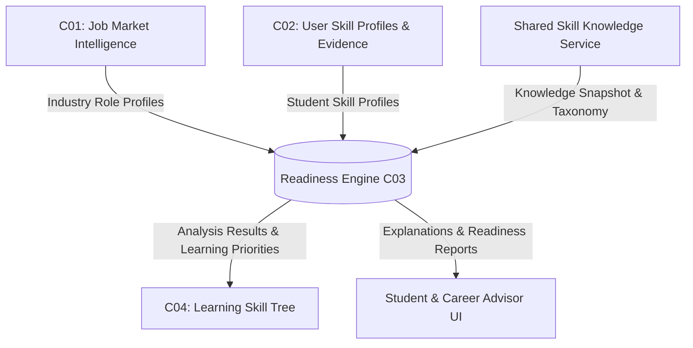
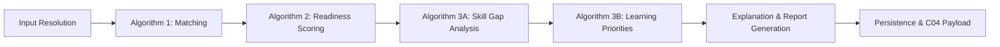
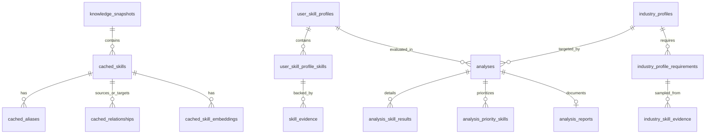
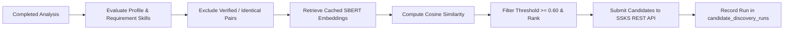

# Skill Gap Analysis and Career Readiness Engine (`readiness-engine`)

**Component ID:** C03 — Skill Gap Analysis and Career Readiness Engine  
**Project:** Skillaro Career Readiness Platform

The **Readiness Engine** evaluates student career readiness against real-world industry demands, identifies actionable skill gaps, and prioritizes learning needs. It bridges the gap between verified industry role targets from C01 (Job Market Intelligence Engine) and student skill profiles from C02 (Student Profile and Evidence Verification Service), using the shared canonical taxonomy and relationship graph from the Shared Skill Knowledge Service (SSKS). Downstream, it produces deterministic reports and payload contracts consumed by C04 (Learning Skill Tree and Recommendation Engine).

---

## 1. System Architecture & Component Interactions



### Upstream & Downstream Roles

- **Upstream Inputs:**
  - **C01 (Market Intelligence):** Authoritative industry role profiles, required skills, proficiency targets, demand weights, and job posting frequency evidence.
  - **C02 (Student Profiles):** Verified student skill claims, proficiency levels, normalized scores, and evidence records (coursework, projects, certifications, CV excerpts).
  - **SSKS (Knowledge Service):** Authoritative canonical skills, verified surface aliases, typed hierarchical/compositional relationships, and 1536-dimensional semantic embeddings.
- **Downstream Outputs:**
  - **C04 (Learning Skill Tree):** Canonical learning priority recommendations, gap severity classifications, and prerequisite dependencies.
  - **Advisor & Student Interfaces:** Deterministic explanations, breakdown of covered/partial/missing requirements, and comparison between exact baseline and relationship-aware matching.

---

## 2. Core Analysis Pipeline & Algorithms

The analysis engine coordinates four deterministic algorithms executed in sequence by `AnalysisService`:



### Algorithm 1: Skill Matching Engine (`app/algorithms/matching.py`)

Compares student skill profiles against industry role requirements using an automated dual-matching strategy:

1. **Exact Baseline Matching (`EXACT_BASELINE`):**
   - Strictly requires exact canonical skill ID identity or resolution via verified surface aliases.
   - Ignores taxonomy graph relationships and awards `0.0` credit for non-identical skills.
   - Provides a benchmark reflecting traditional resume screening.
2. **Relationship-Aware Matching (`RELATIONSHIP_AWARE`):**
   - Evaluates exact matches first. Unmatched requirements are checked against verified knowledge graph edges in the active SSKS snapshot.
   - Applies strict directional semantics to prevent invalid generalization assumptions:

| Relationship Type | Valid Direction | Description | Default Coefficient |
|---|---|---|---|
| `EQUIVALENT_TO` | Bidirectional | Semantic equivalence across taxonomies | `1.00` (Full match) |
| `NARROWER_THAN` | `STUDENT_IS_SOURCE` | Student has specialized skill (e.g., MySQL) satisfying broader requirement (e.g., SQL) | `0.75` (Partial credit) |
| `BROADER_THAN` | `STUDENT_IS_TARGET` | Requirement is broad (source) and student has narrower specialization (target) | `0.75` (Partial credit) |
| `PART_OF` | `STUDENT_IS_TARGET` | Student possesses composite stack (e.g., MERN) covering required component (e.g., MongoDB) | `0.75` (Partial credit) |
| `PART_OF` | `STUDENT_IS_SOURCE` | Student possesses component skill (e.g., React) partially satisfying composite stack (e.g., MERN) | `0.50` (Partial credit) |
| `RELATED_TO` | Any | Informal topical link; no capability guarantee | `0.00` (Excluded) |
| `PREREQUISITE_OF` | Any | Learning order dependency; not substitutable | `0.00` (Excluded) |

3. **Deterministic Candidate Selection & Tie-Breaking:**
   - Candidate ranking order: Priority (`EXACT` > `ALIAS` > `EQUIVALENT` > `PARTIAL`) $\to$ Coverage credit descending $\to$ Preference for unallocated skills $\to$ Stable relationship ID $\to$ Student skill ID.

### Algorithm 2: Career Readiness Scoring (`app/algorithms/scoring.py`)

Computes a normalized readiness score $[0.0, 1.0]$ representing overall role alignment:

$$\text{Readiness Score} = \sum_{i=1}^{N} \left( \overline{w}_i \times c_i \times \text{prof\_factor}_i \times \text{conf\_factor}_i \right)$$

- **Normalized Demand Weight ($\overline{w}_i$):** Requirement weights normalized so $\sum \overline{w}_i = 1.0$.
- **Match Coverage Credit ($c_i$):** Credit awarded by Algorithm 1 ($1.0$ for exact/equivalent, $0.50 - 0.75$ for partial relationships, $0.0$ for missing).
- **Proficiency Factor:** Compares student proficiency score against required threshold.
- **Evidence Confidence Factor:** Accounts for verification strength and provenance of backing evidence.

### Algorithm 3A: Skill Gap Analysis (`app/algorithms/gap_analysis.py`)

Categorizes every role requirement into one of three distinct operational sets:
- **Covered Skills:** Requirements with full coverage credit ($c_i \ge 1.0$) and satisfied proficiency.
- **Partially Covered Skills:** Requirements covered via relationship credit ($0.0 < c_i < 1.0$) or where student proficiency is below target.
- **Missing Skills:** Requirements with zero candidate matches ($c_i = 0.0$).

### Algorithm 3B: Learning Priority Ranking (`app/algorithms/learning_priorities.py`)

Ranks skill gaps to guide targeted curriculum and learning tree generation:
- Calculates **Priority Score** combining demand weight, gap magnitude, role criticality, and learning urgency.
- Classifies learning urgency into `CRITICAL`, `HIGH`, `MEDIUM`, or `LOW`.
- Provides prerequisite and difficulty metadata for downstream graph construction in C04.

### Deterministic Explanation & Report Generation (`app/services/explanation_service.py`)

Generates structured, reproducible markdown reports from persisted analysis records:
- Executive summary with readiness score and baseline comparison.
- Detailed breakdown of covered, partially covered, and missing requirements with explicit rationale.
- Actionable learning recommendations sorted by urgency.

---

## 3. Database Architecture & Relational Schema

The service manages 16 relational entities in PostgreSQL (`readiness_engine_db`) without external migration tooling. Tables and extensions (`pgvector`, `uuid-ossp`) are automatically validated and initialized on startup.



### Table Definitions

| Domain | Table Name | Purpose & Key Columns |
|---|---|---|
| **Knowledge Cache** | `knowledge_snapshots` | Versioned SSKS taxonomy snapshots (`snapshot_id`, `version`, `status`, `is_active`). |
| | `cached_skills` | Canonical skill entities (`snapshot_id`, `skill_id`, `preferred_name`, `skill_type`, `domain_codes`). |
| | `cached_aliases` | Normalized surface terms (`snapshot_id`, `alias_id`, `skill_id`, `normalized_alias`). |
| | `cached_relationships` | Directed taxonomy edges (`snapshot_id`, `relationship_id`, `source_skill_id`, `target_skill_id`, `relationship_type`, `verification_status`). |
| | `cached_skill_embeddings` | 1536-dimensional semantic vectors stored via `pgvector` (`Vector(1536)`). |
| **Student Profiles** | `user_skill_profiles` | Student profile headers (`id`, `user_id`, `profile_version`, `completeness_score`, `raw_payload`). |
| | `user_skill_profile_skills` | Normalized student skills (`id`, `user_skill_profile_id`, `skill_id`, `standard_name`, `proficiency_level`, `proficiency_score`, `verification_status`). |
| | `skill_evidence` | Backing evidence records (`id`, `user_skill_profile_skill_id`, `evidence_id`, `source_type`, `excerpt`, `strength`, `verified`). |
| **Industry Profiles** | `industry_profiles` | Target role definitions (`id`, `role_id`, `primary_observed_title`, `career_level`, `profile_version`). |
| | `industry_profile_requirements` | Role skill demands (`id`, `industry_profile_id`, `skill_id`, `standard_name`, `required_proficiency_level`, `demand_weight`). |
| | `industry_skill_evidence` | Market job ad excerpts (`id`, `requirement_id`, `source_id`, `job_title`, `text_excerpt`). |
| **Analysis Results** | `analyses` | Analysis run execution header (`analysis_id`, `user_id`, `readiness_score`, `matching_method`, `status`, `started_at`, `completed_at`). |
| | `analysis_skill_results` | Per-requirement evaluation (`analysis_id`, `requirement_id`, `matched_skill_id`, `match_type`, `coverage_credit`, `result_status`, `selected_relationship_id`). |
| | `analysis_priority_skills` | Ordered learning priorities (`analysis_id`, `skill_id`, `rank`, `priority_score`, `learning_urgency`). |
| | `analysis_reports` | Generated deterministic reports (`analysis_id`, `report_title`, `executive_summary`, `markdown_body`, `generated_at`). |
| | `candidate_discovery_runs` | Discovery audit logs (`run_id`, `status`, `matches_discovered`, `created_at`). |

---

## 4. Demo Profiles & Seed Fixtures

The service includes repeatable seed data for three standardized demo personas:

| Candidate | Fixed User ID | Target Role ID & Name | Profile Fixture | Key Characteristics |
|---|---|---|---|---|
| **Software Testing Intern** | `677add2f-c700-4346-8980-a09c4924c665` | `RL-000003` — Software Testing Intern | `seed/user-skill-profiles/user_skill_profile_02.json` | Has test planning, test levels, documentation, Python, Git, and MySQL (`SK-000878`). Exercises relationship matching where MySQL satisfies SQL (`SK-000499`) via `REL-000002` (`NARROWER_THAN`). |
| **Junior Web Developer** | `1f40007d-6a6c-49ff-b8cc-dea297d258f2` | `RL-000015` — Junior Web Developer | `seed/user-skill-profiles/user_skill_profile_01.json` | Profile `321c7841-c890-4808-a128-9ac119f1d7e1` with 11 skills (JS, CSS, HTML, Tailwind, Express, Node, React `SK-001606`, Git, transferable skills). Exercises `PART_OF` matching where React satisfies MERN Stack (`SK-001881`). |
| **Junior Data Analyst** | `dfad8a0d-0654-4962-84c9-b3eda380a294` | `RL-000017` — Junior Data Analyst | `seed/user-skill-profiles/user_skill_profile_03.json` | Has data analysis, statistics, Excel, Power BI, SQL, Python, critical thinking, and technical communication. |

---

## 5. Management & Seeding Scripts (`scripts/`)

All utility scripts reside inside the `scripts/` directory and can be executed from the repository root or the service directory:

### Seed Demo Student Profiles (`scripts/seed_demo_student_profiles.py`)
Idempotent script to seed all three demo student profiles, skills, and evidence:
```bash
# From repository root:
python services/readiness-engine/scripts/seed_demo_student_profiles.py

# From services/readiness-engine:
python scripts/seed_demo_student_profiles.py
```
- Validates all skill IDs against `cached_skills` prior to insertion.
- Preserves existing student records (such as profile `321c7841-...`) without duplicating rows.
- Uses transactional commit with automatic rollback on error.

### Import Industry Profiles (`scripts/import_industry_profiles.py`)
Imports and upserts industry role profile fixtures from `seed/industry-role-profiles/`:
```bash
python services/readiness-engine/scripts/import_industry_profiles.py
```

### Generate Skill Embeddings (`scripts/generate_embeddings.py`)
Generates 1536-dimensional OpenAI/Gemini embeddings for cached skills and persists them into `cached_skill_embeddings` for semantic candidate discovery:
```bash
python services/readiness-engine/scripts/generate_embeddings.py
```

---

## 6. Endpoints & API Reference

All routes are mounted under both `/` and the `/readiness` prefix alias.

| Method | Path | Description | Key Query / Body Parameters |
|---|---|---|---|
| `GET` | `/health`, `/readiness/health` | Service health status | None |
| `POST` | `/analyses`, `/readiness/analyses` | Initiate analysis and return C04 contract | JSON body: `user_id` or `user_skill_profile_id`, `role_id` or `industry_profile_id` |
| `GET` | `/analyses`, `/readiness/analyses` | List historical analysis executions | `user_id`, `role_id`, `status`, `limit`, `offset` |
| `GET` | `/analyses/{analysis_id}` | Detailed execution results per requirement | Path: `analysis_id` (UUID) |
| `GET` | `/analyses/{analysis_id}/c04` | Retrieve downstream C04 payload contract | Path: `analysis_id` (UUID) |
| `GET` | `/analyses/{analysis_id}/report` | Retrieve deterministic explanation and report | Path: `analysis_id` (UUID) |
| `GET` | `/readiness/docs` | Interactive OpenAPI documentation | None |

### Example: Triggering Career Readiness Analysis

**Request:**
```http
POST /readiness/analyses HTTP/1.1
Host: localhost:8010
Content-Type: application/json

{
  "user_id": "677add2f-c700-4346-8980-a09c4924c665",
  "role_id": "RL-000003"
}
```

**Response (Summary Excerpt):**
```json
{
  "analysis_id": "4a71b123-5e82-41f2-9c31-7b018e612a45",
  "user_id": "677add2f-c700-4346-8980-a09c4924c665",
  "target_role": {
    "role_id": "RL-000003",
    "role_name": "Software Testing Intern"
  },
  "career_readiness": {
    "overall_readiness_score": 0.88,
    "confidence_score": 0.85,
    "matching_method": "RELATIONSHIP_AWARE",
    "baseline_comparison": {
      "exact_baseline_score": 0.76,
      "relationship_aware_score": 0.88,
      "score_delta": 0.12
    }
  },
  "skills_gap_analysis": {
    "covered_skills": [
      { "skill_id": "SK-000263", "skill_name": "plan software testing", "coverage_score": 1.0 },
      { "skill_id": "SK-000389", "skill_name": "levels of software testing", "coverage_score": 1.0 },
      { "skill_id": "SK-000353", "skill_name": "provide software testing documentation", "coverage_score": 1.0 },
      { "skill_id": "SK-000591", "skill_name": "Python (computer programming)", "coverage_score": 1.0 }
    ],
    "partially_covered_skills": [
      {
        "skill_id": "SK-000499",
        "skill_name": "database management systems",
        "coverage_score": 0.75,
        "matched_skill_id": "SK-000878",
        "matched_skill_name": "MySQL",
        "relationship_id": "REL-000002",
        "relationship_type": "NARROWER_THAN"
      }
    ],
    "missing_skills": []
  },
  "learning_priorities": [
    {
      "rank": 1,
      "skill_id": "SK-000499",
      "skill_name": "database management systems",
      "priority_score": 0.32,
      "learning_urgency": "MEDIUM"
    }
  ]
}
```

For complete payload contracts, headers, and schemas, consult [`docs/api-reference.md`](docs/api-reference.md).

---

## 7. Semantic Candidate Discovery & SSKS Integration

The **Candidate Discovery** subsystem (`app/services/candidate_discovery_service.py`) identifies potentially meaningful relationships between industry requirements and student profile skills using semantic embedding similarity, proposing them as `RELATED_TO` candidates to the Shared Skill Knowledge Service (SSKS) for editorial review.



### Core Architecture & Workflow

1. **Broadened Skill Pair Generation:**
   - Evaluated after the primary readiness analysis completes.
   - Generates candidate pairs across all industry requirements and student profile skills in the analysis, including skills that have already contributed to matches.
   - Pairs already connected by verified taxonomy edges (in either direction) or resolved to identical canonical IDs are strictly excluded.
2. **Reusing Cached Embeddings:**
   - Embeddings are retrieved directly from `cached_skill_embeddings` for the active snapshot without invoking external embedding APIs during analysis.
   - Incompatible models, missing embeddings, or mismatched dimensions are skipped safely.
3. **Cosine Similarity & Ranking:**
   - Evaluated with zero-vector and dimension guards:
     $$\text{cosine\_similarity}(\vec{u}, \vec{v}) = \frac{\vec{u} \cdot \vec{v}}{\|\vec{u}\|_2 \|\vec{v}\|_2}$$
   - Filtered against a configurable similarity threshold (default `0.60`).
   - Sorted in descending order of similarity with deterministic tie-breaking by canonical skill identifiers, capped at `candidate_max_submissions_per_run` (default `10`).
4. **SSKS Candidate Submission Contract:**
   - Submits proposals to `POST /ssks/candidates/relationships`.
   - **Payload Schema (`CandidateRelationshipCreate`):**
     - `source_skill_id`: Student canonical skill ID.
     - `target_skill_id`: Industry requirement canonical skill ID.
     - `proposed_relationship_type`: `"RELATED_TO"` (the generic semantic association supported by SSKS; hierarchical relationships are never inferred from similarity alone).
     - `confidence_score`: Rounded cosine similarity score.
     - `source_id`: `null` (since SSKS enforces foreign key constraint to `knowledge_sources`).
     - `review_note`: Free-text correlation string recording origin component `C03`, `analysis_id`, and cosine similarity.
   - **Idempotency & Retries:** Bounded exponential backoff retries transient 5xx/network errors; HTTP 409 Conflict responses (existing pending/canonical relationships) are gracefully handled as deduplicated success.
5. **Strict Scoring Separation & Asynchronous Execution:**
   - Candidate discovery is an asynchronous supporting workflow executed via FastAPI `BackgroundTasks`.
   - **Candidate discovery never alters readiness scores, matching outputs, gap calculations, learning priorities, or reports.**
   - Unverified candidates receive `0.0` readiness credit.
   - SSKS retains sole authority for relationship review, verification, and canonical promotion.
6. **Persistence & Run Tracking:**
   - Tracked exclusively at the run level in the existing `candidate_discovery_runs` table (`analysis_id`, `embedding_model`, `similarity_threshold`, `status`, `candidates_submitted_count`, `started_at`, `completed_at`).
   - Run statuses: `RUNNING`, `COMPLETED`, `PARTIALLY_COMPLETED`, or `FAILED`.
   - **No individual candidate records or pairs are persisted in the C03 database.**

> **Notice:** The SSKS submission integration has been verified against the SSKS REST API specification using automated unit tests with mocked endpoints.

---

## 8. Configuration & Environment Variables

Settings are loaded through Pydantic Settings with automatic `.env` resolution:

| Variable | Type | Default | Description |
|---|---|---|---|
| `SERVICE_NAME` | string | `readiness-engine` | Service name identifier |
| `VERSION` | string | `0.1.0` | API version string |
| `DATABASE_URL` | string | `postgresql+asyncpg://...` | Async PostgreSQL connection string |
| `SSKS_BASE_URL` | string | `http://localhost:8005` | Base URL for Shared Skill Knowledge Service |
| `CANDIDATE_SIMILARITY_THRESHOLD` | float | `0.60` | Minimum cosine similarity required to propose relationship candidate |
| `CANDIDATE_MAX_SUBMISSIONS_PER_RUN` | int | `10` | Maximum candidate relationship submissions per discovery run |
| `CANDIDATE_DISCOVERY_EMBEDDING_MODEL` | string | `sentence-transformers/all-MiniLM-L6-v2` | Embedding model identifier matching cached embeddings |
| `CANDIDATE_DISCOVERY_TIMEOUT_SECONDS` | float | `10.0` | HTTP request timeout for SSKS candidate submission |
| `CANDIDATE_DISCOVERY_MAX_RETRIES` | int | `3` | Maximum retry attempts for transient SSKS submission failures |

---

## 9. Local Development & Docker Instructions

### Local Python Environment

```bash
cd services/readiness-engine
python -m venv .venv
source .venv/bin/activate  # On Windows: .venv\Scripts\activate
pip install -r requirements.txt
```

Run the development server:
```bash
uvicorn app.main:app --host 0.0.0.0 --port 8010 --reload
```

Interactive OpenAPI documentation will be accessible at:  
`http://localhost:8010/readiness/docs`

### Docker Deployment

The Readiness Engine runs as part of the Skillaro infrastructure stack:

```bash
# Start PostgreSQL and dependencies from infrastructure directory:
cd infrastructure
docker-compose up -d postgres readiness-engine
```

- **Container Port:** `8010`
- **Gateway Mapped Port:** `8081` (via API gateway at `http://localhost:8081/readiness/...`)
- **PostgreSQL Port:** `15432` (host) $\to$ `5432` (internal)
